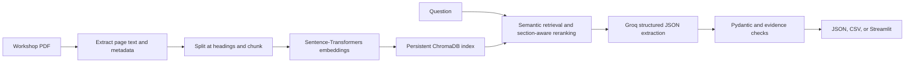

# Vehicle Specification Extraction System

An evidence-grounded RAG application for finding vehicle specifications and
service procedures in the supplied 2014 Ford F-150 Workshop Manual. It indexes
page-aware PDF text, retrieves relevant passages, and returns Pydantic-validated
JSON or CSV with the supporting PDF page, section, evidence ID, and passage.

The supplied assignment calls for text extraction, logical chunking and
embeddings, vector retrieval, LLM-based structured extraction, JSON/CSV output,
and a clear Python repository with a README. Those components are implemented
here; the included evaluation set and limitations are described below.


## Project contents

```text
vehicle-specification-extractor/
  data/
    Assignment-specs-extraction 1.pdf
    sample-service-manual 1.pdf
  evaluation/
    fixtures/evaluation_cases.json
    reports/                       # baseline and latest evaluation reports
  tests/
  SUBMISSION_CHECKLIST.md
  vehicle_spec_extractor/
    chunking.py
    cli.py
    config.py
    evaluate.py
    extraction.py
    ingestion.py
    pipeline.py
    schemas.py
    streamlit_app.py
    vector_store.py
  .env.example
  pyproject.toml
  requirements.txt
```

The PDF text loader and Chroma/Sentence-Transformers store are self-contained
modules in this project. No previous repository, API, package, or `PYTHONPATH`
entry is required. The PDF loader uses `pypdf`; chunking uses
`langchain-text-splitters`; Chroma storage and normalized Sentence-Transformers
embeddings are implemented in the local `vector_store.py`. Some generic
PDF/vector-store logic was adapted from the earlier workspace implementation.

## How the pipeline works



1. `ingestion.py` extracts text from each PDF page and records its 1-based page
   number and source filename. It skips pages with no text; OCR is outside scope.
2. `chunking.py` splits text at recognized manual headings before applying a
   size and overlap limit. Every chunk retains page and section metadata.
3. `vector_store.py` embeds chunks with a normalized Sentence-Transformers
   model and stores them in a persistent Chroma collection. A manual fingerprint
   gives each source PDF its own collection.
4. `pipeline.py` embeds the question, retrieves candidate chunks, filters an
   explicitly requested manual section, and boosts lexical/section matches.
   Torque queries prioritize matching specification-table rows.
5. `extraction.py` sends up to three evidence passages to Groq using strict JSON
   Schema output. Pydantic validates the response; local checks confirm each
   value/unit is present in the cited passage before returning it.
6. `cli.py` exports JSON or CSV. `streamlit_app.py` provides a browser UI with
   visible source passages and downloadable results. `evaluate.py` scores a
   manually checked fixture and writes a per-case JSON report.

## Requirements

- Windows and Python 3.12.
- Internet access for dependency/model downloads on first setup.
- A Groq API key for question answering and live evaluation. Ingestion and
  mocked unit tests do not require the key.

## Install (PowerShell)

Run all commands from this project's root, `vehicle-specification-extractor`:

```powershell
$ErrorActionPreference = "Stop"
python --version  # confirm this is Python 3.12.x
python -m venv .venv
if ($LASTEXITCODE -ne 0) { throw "Virtual environment creation failed." }

$Python = (Resolve-Path ".\.venv\Scripts\python.exe").Path
& $Python -m pip install --upgrade pip
if ($LASTEXITCODE -ne 0) { throw "pip upgrade failed." }

& $Python -m pip install -e ".[dev]"
if ($LASTEXITCODE -ne 0) { throw "Project dependency installation failed." }

if (-not (Test-Path ".env")) {
    Copy-Item ".env.example" ".env"
}
```

Alternatively, install the pinned runtime and test dependencies with
`.\.venv\Scripts\python.exe -m pip install -r requirements.txt`.

Set `GROQ_API_KEY` in the project-root `.env` file for extraction and evaluation.
Keep `.env` private; it is excluded from version control. The embedding model
downloads the first time the index is built. The default Groq model is
`openai/gpt-oss-20b` for lower response latency; set `GROQ_FAST_MODEL` in `.env`
to another model available to your Groq account if needed. The extractor uses
strict JSON Schema output, so a custom model must support Groq Structured
Outputs; check the [supported-model list](https://console.groq.com/docs/structured-outputs)
before overriding the default.

## Ingest the supplied manual

From the project root:

```powershell
$Python = (Resolve-Path ".\.venv\Scripts\python.exe").Path
& $Python -m vehicle_spec_extractor.cli ingest "data\sample-service-manual 1.pdf"
if ($LASTEXITCODE -ne 0) { throw "Manual ingestion failed." }
```

The index is stored in `artifacts\chroma_db` by default. This generated index is
excluded from the submission folder and is rebuilt by the ingest command. A
manual fingerprint
selects a separate collection; re-ingesting the same manual upserts stable chunk
IDs. Set `VEHICLE_SPEC_CHROMA_DIR` or pass `--persist-dir` to choose another
index location. Torque questions search the torque tables first and prioritize
matching component rows, rather than sending unrelated procedure passages to
the model. General retrieval blends vector similarity with query-term and
explicit section matches. At most three evidence chunks are sent for extraction
to keep the model context focused. Groq strict JSON Schema output constrains the
response shape; Pydantic and passage checks still validate the actual claims.

## Ask questions and export results

The CLI prints JSON by default:

```powershell
& $Python -m vehicle_spec_extractor.cli ask `
  "data\sample-service-manual 1.pdf" `
  "What is the torque for the upper ball joint nut in Section 204-01A?"
```

For CSV output:

```powershell
& $Python -m vehicle_spec_extractor.cli ask `
  "data\sample-service-manual 1.pdf" `
  "What is the torque for the upper ball joint nut in Section 204-01A?" `
  --format csv
```

Windows paths containing spaces work when quoted. An ask command requires that
the manual has already been indexed and a valid Groq key is configured.

### Output shape

Each result includes `component`, `spec_type`, `value`, `unit`, `status`,
`citations`, and `conflicting_values`. A citation contains an evidence ID, source
PDF, 1-based PDF page number, section label, and supporting passage.

```json
{
  "query": "What is the torque for the upper ball joint nut?",
  "results": [
    {
      "component": "Upper ball joint nut",
      "spec_type": "Torque",
      "value": "115",
      "unit": "Nm",
      "status": "found",
      "citations": [
        {
          "evidence_id": "retrieved-chunk-id",
          "source_file": "sample-service-manual 1.pdf",
          "page": 24,
          "section": "SECTION 204-01A / Torque Specifications",
          "passage": "Upper ball joint nut 115 85 ..."
        }
      ],
      "conflicting_values": []
    }
  ]
}
```

The values above are present in the source manual's page 24 torque table. Page
citation numbers count pages in the PDF from 1; they may differ from printed
page labels inside the manual.

## Streamlit UI

Run from the project root:

```powershell
$Python = (Resolve-Path ".\.venv\Scripts\python.exe").Path
& $Python -m streamlit run vehicle_spec_extractor\streamlit_app.py
```

Open the Local URL printed by Streamlit. The app can use the supplied manual or
an uploaded PDF, displays the query, retrieval evidence, validated result and
status, and provides JSON/CSV downloads. Stop the server with **Ctrl+C**.

## Evaluation

The fixture `evaluation/fixtures/evaluation_cases.json` contains 26 manually
checked questions based on text in PDF pages 8, 24, and 59:

- 20 torque-table cases for RWD/4WD entries, values, and unit columns.
- Two procedure questions from the Ball Joint Inspection section.
- Two missing-value checks for a fluid capacity and part number not stated in
  that procedure.
- Two trim-unspecified questions where the 4WD table distinguishes standard
  and SVT Raptor torque values.

The fixture answers were checked against the supplied PDF text. In the checked
manual, PDF page 24 includes the RWD upper ball joint nut values `115 Nm` and
`85 lb-ft`; page 59 includes both the standard and SVT Raptor rows for the
ambiguity cases; page 8 states that the suspension must be in full rebound and
identifies Steps 4 through 6 for lower-ball-joint inspection. The missing-value
cases ask for a fluid capacity and part number that are not stated in that
procedure.

Run evaluation from the project root:

```powershell
& $Python -m vehicle_spec_extractor.evaluate `
  "data\sample-service-manual 1.pdf" `
  --top-k 5 `
  --output "evaluation\reports\live_evaluation_report.json"
if ($LASTEXITCODE -ne 0) { throw "Evaluation failed." }
```

Evaluation ingests the manual before running the cases. The JSON report includes
per-case expected and actual statuses/values, retrieved and cited pages, and
failed checks, as well as the aggregate metrics. Groq structured-output or
connection errors are retried once; if extraction still errors for a case,
evaluation records it as an extraction failure and continues through the
fixture. The formulas are:

- **Retrieval Recall@k:** distinct retrieved relevant pages divided by relevant
  pages for each case, averaged over all cases.
- **Extraction accuracy:** cases with exact expected status and value/unit set
  divided by all cases.
- **Citation accuracy:** answer cases whose returned citations are on expected
  source pages, plus correctly handled `not_found` cases, divided by all cases.
- **Missing-value detection:** `not_found` cases correctly returned without
  values or citations divided by expected missing-value cases.

The baseline run from 2026-10-21 is saved at
`evaluation/reports/baseline_live_evaluation_2026-10-21.json`. After the latest
retrieval and extraction improvements, the 26-case live evaluation is saved at
`evaluation/reports/live_evaluation_report.json`. It measured Recall@5
**100%**, extraction accuracy **80.8% (21/26)**, citation accuracy
**88.5% (23/26)**, and missing-value detection **100% (2/2)**. The five
remaining failed cases are two inconsistent torque answers, two procedure
questions returned as not found, and one trim-dependent stabilizer-link
question returned as found instead of ambiguous. These results describe a
small, manually checked fixture only; they do not establish general manual
coverage or safety. Verify every answer against the cited manual pages before
using a specification in repair work.

### Current verification record

- Fresh project-local Python 3.12.10 environment installed the editable project
  and dependencies; `pip check` reported no broken requirements.
- Automated tests after the latest retrieval and extraction improvements:
  **27 passed**.
- Real ingestion: **852 pages with text and 1,470 chunks indexed**.
- Live Groq/Streamlit smoke test returned the upper ball joint torque as
  `115 Nm`, with supporting citations on PDF pages 24 and 59.
- The project `.env` has a Groq key configured locally; never copy it into
  source files or share it. The default model is `openai/gpt-oss-20b`.
- Baseline and final live 26-case evaluations completed on 2026-10-21. The
  reports are saved in `evaluation/reports/`.
- Streamlit returned HTTP 200 and the query/result/download interface was
  exercised in the browser.

## Tests

Run tests offline from the project root:

```powershell
& $Python -m pytest
if ($LASTEXITCODE -ne 0) { throw "Tests failed." }
```

The unit suite uses mocked LLM responses and PDF-reader fixtures, so tests do
not make Groq calls or require a populated Chroma index.

## Evidence and status rules

- `found`: the component/value is present in cited evidence; torque rows are
  checked against table unit columns when those headers are available.
- `not_found`: no supported value is returned, including when retrieval is
  empty or a proposed claim does not pass evidence validation. Contradictory
  `not_found` responses and incomplete `found` or `ambiguous` claims are
  downgraded to `not_found` with unsupported values and citations discarded.
- `ambiguous`: two or more distinct, evidence-supported values conflict. Each
  candidate is tied to its own cited passage.

Unknown evidence IDs and malformed model responses fail explicitly. Retrieved
text alone does not establish a supported claim; component, value, unit, and
citation are checked before a value is returned. No value is inferred from
general automotive knowledge.

## Troubleshooting

- **`GROQ_API_KEY is required`:** set the key in `.env` at the project root.
- **Manual not indexed:** run the `ingest` command before `ask`.
- **Missing vector/PDF dependencies:** install the project's requirements using
  the project-local `.venv`.
- **Slow first indexing:** Sentence-Transformers downloads the embedding model
  on first use; allow network access and sufficient disk space.
- **Slow first question after restart:** the local embedding model is loaded
  into memory on the first retrieval. Keep the Streamlit process running so
  later questions can reuse it.
- **PowerShell path errors:** run commands from the project root and quote PDF
  paths that contain spaces.

## Limitations and future work

- Text-only extraction follows the assignment; diagrams and image-only pages
  are ignored, and OCR is not implemented.
- Section recognition is heuristic and may need adjustment for other manuals.
- PDF table text extraction can lose layout or merged-cell context; torque
  verification is deliberately conservative and is not a general entailment
  proof.
- Retrieved passage verification cannot replace a domain expert, especially for
  safety-critical repair decisions.
- The current evaluation fixture is narrow. Future work should broaden manual
  coverage, independently review more cases, add layout-aware table parsing,
  and assess retrieval/extraction across multiple manuals.
